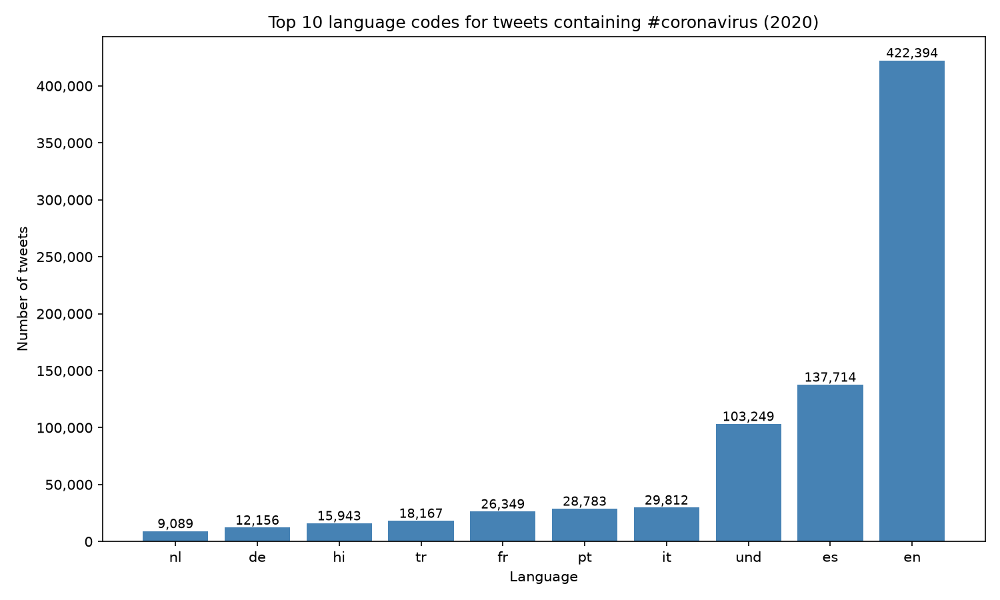
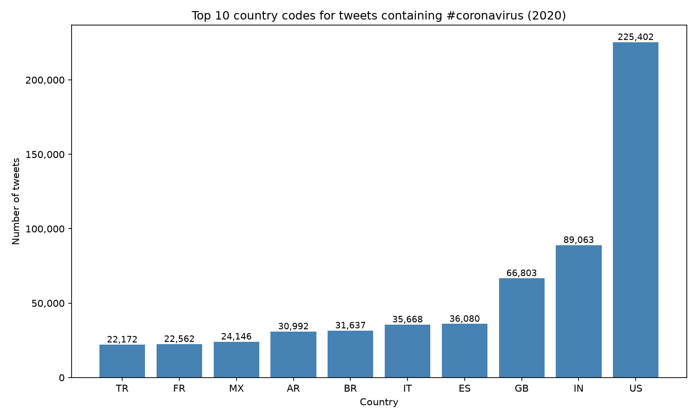
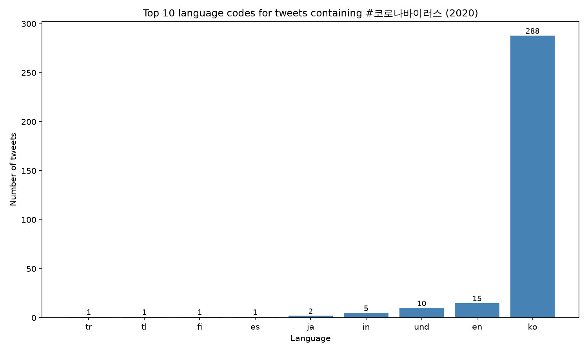
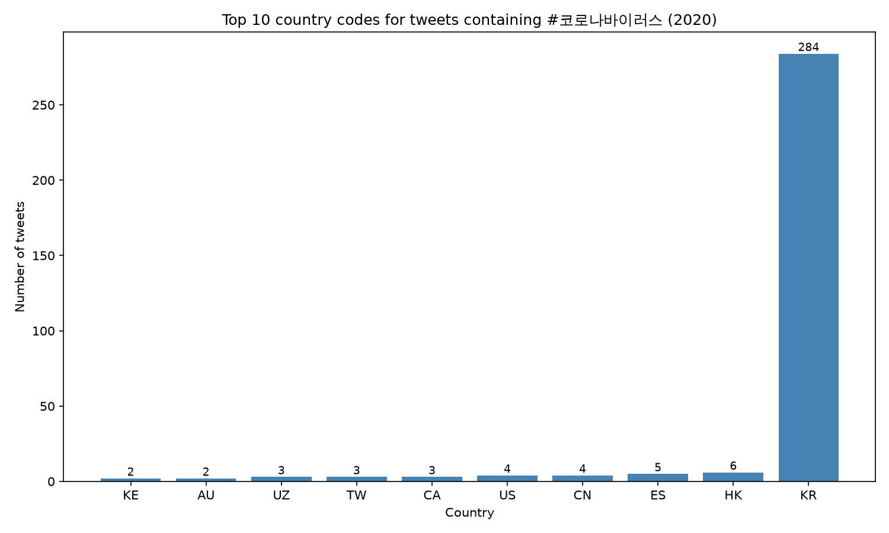
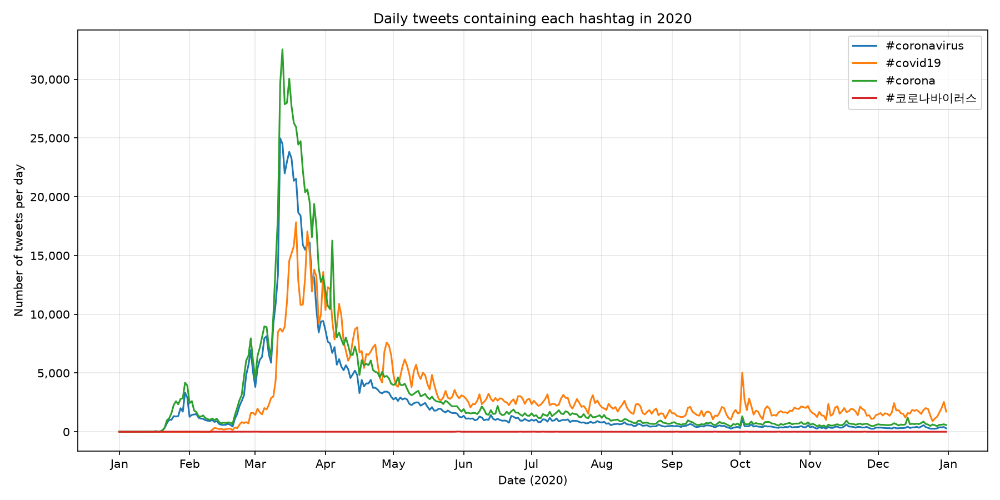

# Coronavirus Twitter Analysis

Analysis of all geotagged tweets from 2020 (about 1.3 billion), tracking coronavirus-related hashtags by language, country, and day.

## About

This project researches how people discussed the covid-19 pandemic on twitter. The dataset used has 1.3 billion tweets, thus I utilized map reduce and CMC's 80 core computer to run tasks in parallel in order to complete the analysis in under 20 minutes.

## Results

`#coronavirus` was used mostly in English and Spanish, and mostly from the US, India, and the UK.

`#코로나바이러스` (Korean for "coronavirus") was used almost entirely in Korean, from South Korea.

Hashtag use spiked in mid-March 2020, when the pandemic was declared. After that, `#covid19` became the most-used hashtag.

